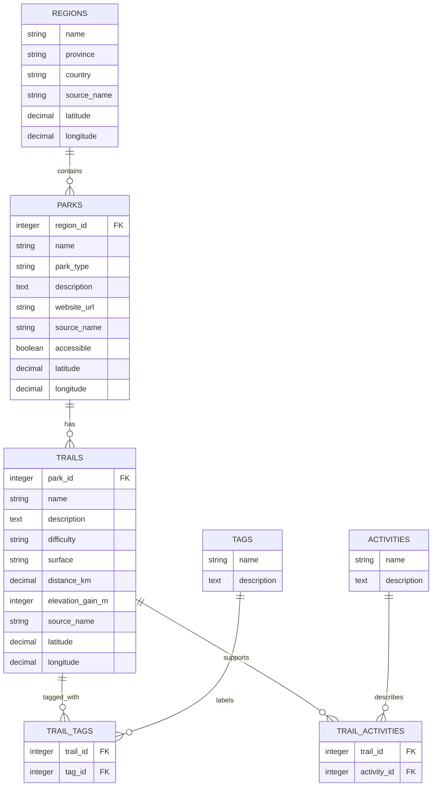

# Trail Atlas

Trail Atlas is a Rails app for exploring Ontario parks and sample trails. Browse by region, search and filter the trail library, open detail pages, and see park and route locations on a map.

> **Data note:** the park list and reference locations are compact, manually curated snapshots. Trail names, descriptions, route measurements, and route coordinates are generated demonstration data, not official trail information. Verify current access and trail conditions with the linked park operator before travelling.

## Requirements

- Ruby 4.0.6 (see `.ruby-version`)
- Rails 8.1.4
- Bundler
- Node.js and npm for the Bootstrap asset build

SQLite is used for local development and tests. No API key or account is required.

## Setup

From the project directory:

```powershell
bundle install
npm install
npm run build:css
bundle exec rails db:prepare
bundle exec rails server
```

Open [http://localhost:3000](http://localhost:3000). On a new database, `db:prepare` loads the checked-in CSV snapshots plus 270 Faker-generated sample trails. Run `bundle exec rails db:seed` later to reset and rebuild the demo data; the seed task is repeatable.

Bootstrap assets are built by `cssbundling-rails`. Re-run `npm run build:css` after editing the stylesheet.

## Running on WSL (Ubuntu)

Use the Linux versions of Ruby, Bundler, Node.js, npm, and SQLite inside WSL; do not use the Windows Ruby or Node executables from the WSL shell. This project pins Ruby `4.0.6` in `.ruby-version` and Node.js `24.18.0` in `.node-version`. Install those versions with your preferred Linux version managers before continuing. Ruby also needs a C compiler and SQLite development headers; on Ubuntu, install them with:

```bash
sudo apt update
sudo apt install -y build-essential pkg-config libssl-dev libyaml-dev zlib1g-dev libffi-dev libreadline-dev libsqlite3-dev sqlite3
```

In the WSL terminal, enter the Windows project folder and install its dependencies:

```bash
cd "/mnt/c/Users/segzy/Rails Intro Project"
ruby --version
node --version
bundle install
npm ci
npm run build:css
bundle exec rails db:prepare
bundle exec rails server
```

Check that `ruby --version` reports `4.0.6` and `node --version` reports `v24.18.0`. Open [http://localhost:3000](http://localhost:3000) in your Windows browser. The `/mnt/c` location is convenient for using the same files from Windows and WSL, though Rails file watching and database I/O can be slower there. For better Linux development performance, keep the working copy under your WSL home directory (for example, `~/projects/trail-atlas`). Keep `node_modules` and installed Ruby gems Linux-native; do not share Windows-installed dependencies with WSL.

## Features

- Responsive Bootstrap navigation and layouts
- Trail search with region and feature filters
- Paginated trail results
- Region → park → trail browsing, with links back through each association
- Many-to-many trail tags and activities
- Leaflet maps using OpenStreetMap tiles
- About page with dataset notes and schema relationships
- Active Record validations, database indexes, and foreign keys

## Data sources and provenance

- **GeoNames** geographical names: `db/data/regions.csv` is a curated reference snapshot of 8 Ontario place names and their latitude/longitude coordinates. [GeoNames](https://www.geonames.org/)
- **Parks Canada, Ontario Parks, and local park operators**: `db/data/parks.csv` is a curated snapshot of 15 park listings. Its columns identify the region, park name and type, coordinates, official website, and responsible source organization. The park names, source organizations, and website links are included for provenance and visitor follow-up; this is not a live API import.
- **Faker**: `db/seeds.rb` creates 18 repeatable demonstration trails for each park (270 trails total), along with sample descriptions, route measurements, coordinates, trail features, and activities. These are sample records only; they do not represent verified routes, distances, elevation, or trail conditions.
- **OpenStreetMap**: live map tiles; map data is not imported into the database. [Attribution and tile usage policy](https://www.openstreetmap.org/copyright).

The map uses approximate reference coordinates to make the navigation demo visible. Confirm locations and conditions with the linked official source before visiting.

## Dataset plan and database design

The region CSV provides the parent location reference. Each park row names one of those regions, so the seed script resolves it by region name and creates a park with a Rails-managed primary key and `region_id`. Faker then creates trails for each park; each trail receives two feature tags and two activities through join records. External dataset identifiers are not used as database primary or foreign keys.

| Dataset / table | Structure and key columns | Relationship / use |
| --- | --- | --- |
| `regions` (`regions.csv`) | `name`, `province`, `country`, `source_name`, `latitude`, `longitude` | A region has many parks. The CSV supplies `name` and coordinates; the seed adds the province, country, and source attribution. |
| `parks` (`parks.csv`) | `region_id`, `name`, `park_type`, `description`, `website_url`, `source_name`, `accessible`, `latitude`, `longitude` | Each park belongs to a region and has many trails. The CSV supplies the region name and park facts; the seed resolves `region_id` and adds a descriptive note. |
| `trails` (Faker demonstration records) | `park_id`, `name`, `description`, `difficulty`, `surface`, `distance_km`, `elevation_gain_m`, `source_name`, `latitude`, `longitude` | Each trail belongs to a park and connects to tags and activities. Faker supplies repeatable demonstration content, not official route information. |
| `tags` | `name`, `description` | Trail features, connected through `trail_tags`. |
| `trail_tags` | `trail_id`, `tag_id` | Join table for the trail/tag many-to-many association. |
| `activities` | `name`, `description` | Trail uses, connected through `trail_activities`. |
| `trail_activities` | `trail_id`, `activity_id` | Join table for the trail/activity many-to-many association. |

Rails also adds each table's `id`, `created_at`, and `updated_at` columns. The schema enforces foreign keys and uniqueness indexes for names and join pairs. A fresh seed creates 8 regions, 15 parks, 270 trails, 8 tags, 6 activities, 540 trail-tag links, and 540 trail-activity links (1,387 rows total).

## Entity-relationship diagram

```text
Region 1 ─── * Park 1 ─── * Trail
                           *  * Tag       (TrailTag)
                           *  * Activity  (TrailActivity)
```



Regions own parks, parks own trails, and trails connect to tags and activities through validated join tables. The About page describes these associations in the running app.

## Tests and checks

```powershell
bundle exec rails test
bundle exec rails zeitwerk:check
bundle exec rails routes
```

The tests cover model validations and associations, search and filtering, detail-page navigation, source disclosure, and repeatable seeds with at least 200 imported records.

## Source control and GitHub

The project is tracked in [GitHub](https://github.com/oadeyemi85/Intro-to-Rails-Project) on the `master` branch. Its implementation was developed and committed in milestones, followed by additional fixes for portable Ruby binstubs, CI checks, and a Rails security update. The repository currently has more than the rubric's required 20 commits.

GitHub Actions runs the checks defined in `.github/workflows/ci.yml` when changes are pushed to `master` or a pull request is opened. Review the [Actions page](https://github.com/oadeyemi85/Intro-to-Rails-Project/actions) for the latest results.

To save future changes and send them to GitHub:

```bash
git status
git add <files-to-include>
git diff --cached --check
git commit -m "Describe the change"
git push
```

The repository is source code, not a deployed public website. Run `bin/rails server` locally and visit [http://localhost:3000](http://localhost:3000) to view the app; stop the server with `Ctrl+C`.
